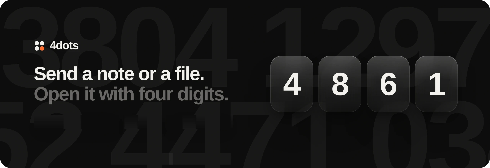

<p align="center">
  
</p>

<p align="center">
  Text, images and files up to 1&nbsp;GB, encrypted in your browser and unlocked with a four-digit code that expires on its own.
</p>

<p align="center">
  <a href="https://4dots.app"><b>Open 4dots.app</b></a>
  &nbsp;·&nbsp;
  <a href="#self-hosted-backend"><b>Self-host</b></a>
  &nbsp;·&nbsp;
  <a href="#quick-start"><b>Quick start</b></a>
  &nbsp;·&nbsp;
  <a href="#how-it-works"><b>How it works</b></a>
  &nbsp;·&nbsp;
  <a href="#security"><b>Security</b></a>
  &nbsp;·&nbsp;
  <a href="docs/README.md"><b>Docs</b></a>
</p>

<br>

<p align="center">
  
</p>

<br>

- **Four digits, that's it.** Write a note or add files and get a code like `4821`. Say it, text it or share the link. No accounts.
- **Sealed on your device.** Everything is encrypted with AES-256-GCM before it leaves the browser. The server and storage only see ciphertext.
- **Gone when it's done.** Drops expire after 10&nbsp;minutes, an hour or a day, can burn after the first open, and can be deleted early.

<br>

## Self-hosted backend

The same app can run against a small backend that writes ciphertext **straight to
storage** — no Cloudflare Worker, no relay, no third-party storage. It speaks the
same API as the Worker, so the frontend in `public/` works unchanged.

- **One file, standard library.** `server.py` needs Python 3.10+ and nothing
  else. It implements the same endpoints as the Worker and keeps metadata in a
  small SQLite database (`state.db`).
- **Same end-to-end encryption.** The browser still seals everything with
  AES-256-GCM; the server only ever sees ciphertext. The PBKDF2 round count is
  served to the browser via `/config.js`.
- **Two storage tiers.** 10-minute and 1-hour drops are written to a **tmpfs**
  (RAM); 24-hour drops are written to the **SSD**. When free memory falls below
  2 GB, every RAM drop is migrated to the SSD and new short-lived drops go there
  too. Codes, names, sizes and bytes are identical before and after.
- **RAM is volatile.** A restart, reboot or power cut destroys RAM-tier drops;
  their codes stop working. Use the 24-hour option for anything that must
  survive. This is written into the terms, privacy page and status page.
- **MIT.** `server.py` is MIT, under the repository's [`LICENSE`](LICENSE). The
  frontend in `public/` is the upstream 4dots frontend, also MIT (see
  [`LICENSE-4dots-frontend`](LICENSE-4dots-frontend)).

### Quick start

```sh
git clone https://github.com/4dotsapp/4dots.git
cd 4dots
cp .env.example .env      # set FOURDOTS_DATA_DIR and, if needed, FOURDOTS_NETWORK
docker compose up -d --build
```

`compose.yaml` runs one service, `fourdots` (container `4dots`), on internal port
8080 and joins the external network in `FOURDOTS_NETWORK`. It has two volumes:

- `${FOURDOTS_DATA_DIR}:/data` — the SSD tier (`/data/drops`) and `state.db`;
- a tmpfs at `/ram` — the RAM tier, sized by `FOURDOTS_RAM_DISK_MB`.

The variables that matter:

| Variable | Default | What it does |
|---|---|---|
| `FOURDOTS_RAM_DIR` | `/ram` | RAM tier root. Must be a real tmpfs or the RAM tier is refused. |
| `FOURDOTS_SSD_DIR` | `/data/drops` | SSD tier root. |
| `FOURDOTS_RAM_MIN_MB` | `2048` | Free memory that must remain before the RAM tier is used. Below this, drops move to the SSD. |
| `FOURDOTS_RAM_MAX_MB` | `0` | Cap on the RAM tier; `0` means 40 % of total memory. |
| `FOURDOTS_ORPHAN_GRACE_SECONDS` | `21600` | Unreferenced files younger than this are treated as uploads in flight and are not deleted by the sweeper. |
| `FOURDOTS_KDF_ITERATIONS` | `600000` | PBKDF2 rounds, served to the browser. |
| `FOURDOTS_SWEEP_SECONDS` | `15` | Tier/expiry sweep interval. |
| `FOURDOTS_DATA_DIR` | `./data` | Host directory mounted at `/data` (read by Compose from `.env`). |
| `FOURDOTS_NETWORK` | `4dots_default` | External Docker network shared with the tunnel. |

### Put it behind your own tunnel

The deployment this repository is tested against uses a **locally-managed**
Cloudflare tunnel: a `config.yml` with an ingress rule plus a `credentials.json`,
run as a separate container on the same Docker network. The shape is:

```yaml
tunnel: <your-tunnel-id>
credentials: /etc/cloudflared/credentials.json
ingress:
  - hostname: drop.example.com
    service: http://4dots:8080
  - service: http_status:404
```

```sh
docker run --rm --network 4dots_default \
  -v /path/to/cloudflared:/etc/cloudflared:ro \
  cloudflare/cloudflared:latest \
  tunnel --no-autoupdate --config /etc/cloudflared/config.yml run
```

Keep the credentials and any tunnel token out of git. A token-managed tunnel
(`cloudflared tunnel run --token …`) works too; configure the hostname in the
dashboard.

The full self-hosting guide — measured numbers, the exact API, migration
guarantees, tuning and security notes — is in
[docs/SELF-HOSTING.md](docs/SELF-HOSTING.md). Operators should start with
[DEPLOY-MAP.md](DEPLOY-MAP.md).

<br>

## In motion

<p align="center">
  
</p>

<p align="center"><sub>Views slide through the glass with real directional motion blur, then the code rolls in like a slot machine. The giant digits drifting behind everything are random. They just give the glass something to bend.</sub></p>

<br>

## Light and dark

<p align="center">
  
</p>

<p align="center"><sub>Follows your system theme: warm black or paper, with one orange accent.</sub></p>

<br>

## On your phone

<p align="center">
  
</p>

<p align="center"><sub>The whole form fits on one screen. Typing digits anywhere jumps straight into the code.</sub></p>

<br>

## How it works

<p align="center">
  
</p>

1. **You get a code.** The server reserves a free four-digit code and hands your browser a one-time upload token.
2. **Your browser seals it.** The note and files are bundled and encrypted in 4&nbsp;MB chunks, with a key derived from the code (PBKDF2, 600k rounds) plus a per-code secret from the server.
3. **The ciphertext is stored.** It goes up in parts of up to 90&nbsp;MB, which the server streams to [nimbo.fun](https://nimbo.fun) under random names. Your nimbo API key never reaches a browser.
4. **They open it.** Their browser downloads the ciphertext and decrypts it as it arrives. Burn-after-reading drops are deleted the moment they're delivered.

<br>

## Quick start: Cloudflare Worker

The instructions in this section run the upstream Worker. For the self-hosted backend, see [Self-hosted backend](#self-hosted-backend).

You need **Node 20+**.

```sh
git clone https://github.com/4dotsapp/4dots.git
cd 4dots
npm install
npm run dev        # localhost:8787, against a mock of the nimbo API
```

`npm run dev` never touches real storage, so you can play with it straight away.

### Run your own

4dots fits on the **Cloudflare Workers free plan**. You need a [nimbo.fun API key](https://nimbo.fun/profile) for storage.

```sh
npx wrangler login
npx wrangler secret put NIMBO_TOKEN   # paste your nimbo API key
npm run deploy
```

Then add your domain under the Worker's **Settings → Domains & Routes**, or set `workers_dev` to `true` in `wrangler.jsonc` for a free `workers.dev` address. Configuration and the API are in the **[docs](docs/README.md)**.

<br>

## Security

> [!IMPORTANT]
> A four-digit code is quick to share and also quick to guess: there are only 10,000 of them. 4dots is built for things that matter for minutes, not secrets that must stay secret forever.

- **Storage can't read your drops.** nimbo.fun sees ciphertext under random names. It never learns the codes or the per-code secrets, so it can't brute-force them either.
- **Guessing is slowed down.** Drops expire, can burn after one open, and each IP gets 12 wrong codes per 10 minutes.
- **Tampering fails loudly.** Every chunk is authenticated and numbered, so a reordered, cut-short or altered drop won't decrypt.
- **The ceiling is honest.** Whoever runs the server holds the secret that makes the keys, and with 10,000 codes they could work them out. No four-digit design can avoid that.

<br>

## Under the hood

- **Frontend:** plain HTML, CSS and JavaScript modules. No framework, no build step.
- **Glass:** `backdrop-filter` with rim lighting and a pointer-following sheen. In Chromium, an SVG displacement map bends the backdrop at the edges like a glass rod.
- **Motion:** animation-frame tweens that blur each moving element along its direction of travel, in proportion to its speed. Devices that can't hold about 40 fps get a lighter mode automatically.
- **Crypto:** Web Crypto, with AES-256-GCM in 4&nbsp;MB chunks and PBKDF2-SHA256 keys.
- **Server:** a Cloudflare Worker that streams every byte straight through, plus one Durable Object that remembers codes, expiry, burns and rate limits.
- **Storage:** the [nimbo.fun](https://nimbo.fun/docs) REST API.
- **Design system:** colours, glass, components and motion are documented in [DESIGN.md](DESIGN.md), so you can build something else with the same look.

<br>

## Licence

MIT — see [`LICENSE`](LICENSE). The frontend in `public/` is the upstream 4dots
frontend, MIT, © the 4dots authors (see
[`LICENSE-4dots-frontend`](LICENSE-4dots-frontend)). The self-hosted backend
(`server.py`, `bench.py`, `e2e_test.py`, `test_tiers.py`, `Dockerfile`,
`compose.yaml`) is MIT under the same licence.

## Contributing

Issues and pull requests are welcome. Found a security problem? Please report it privately, as described in [SECURITY.md](SECURITY.md).

<br>

<p align="center">
  <sub><a href="https://4dots.app">4dots.app</a> · <a href="LICENSE">MIT licensed</a> · <a href="https://4dots.app/privacy">Privacy</a> · <a href="https://4dots.app/terms">Terms</a> · <a href="https://4dots.app/dmca">DMCA</a> · Storage by <a href="https://nimbo.fun">nimbo.fun</a></sub>
</p>
