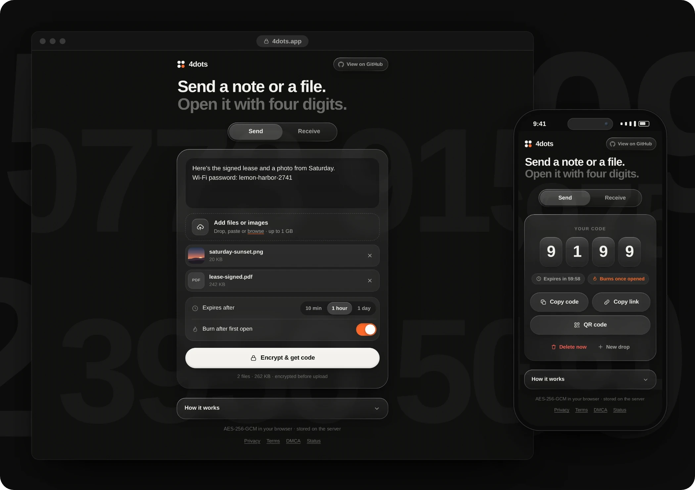
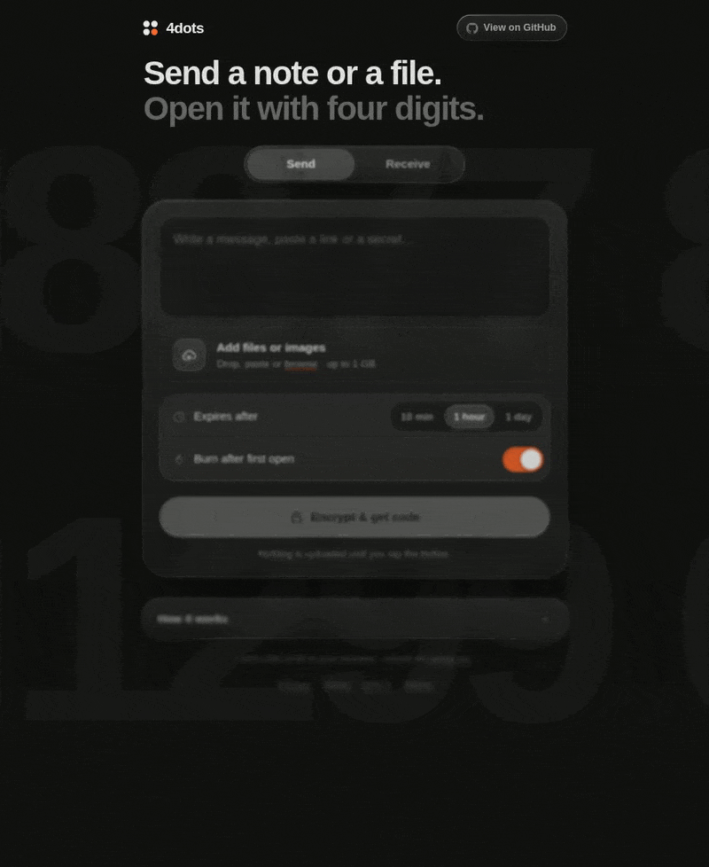
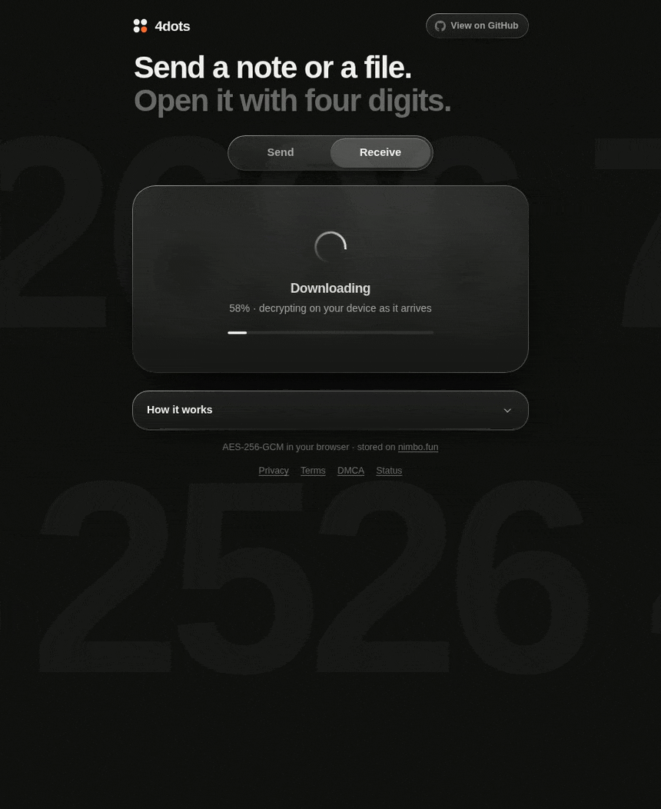
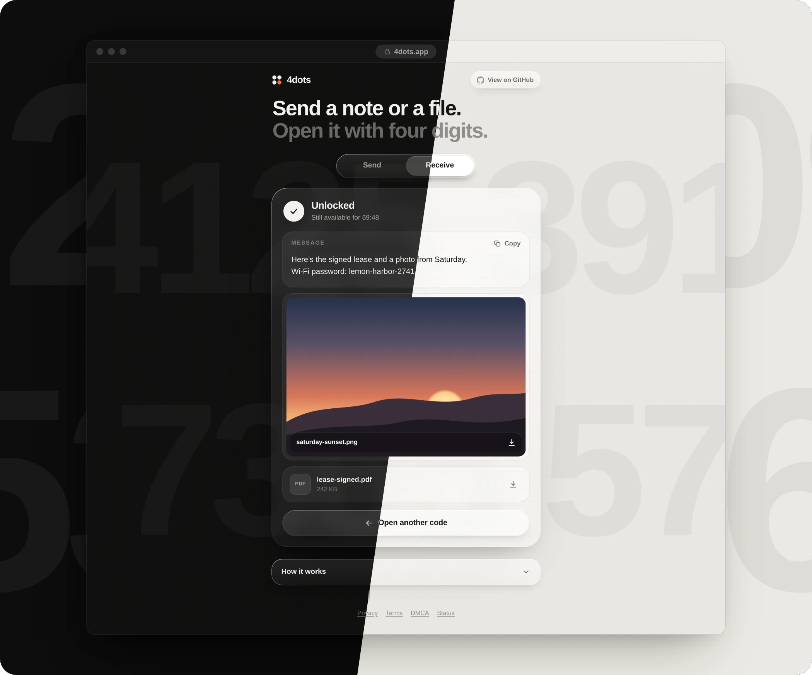
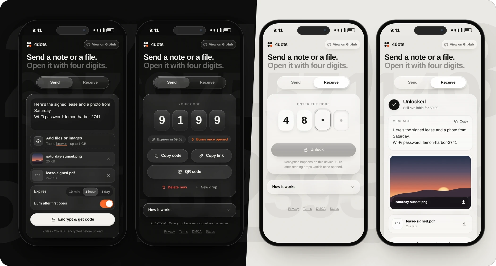
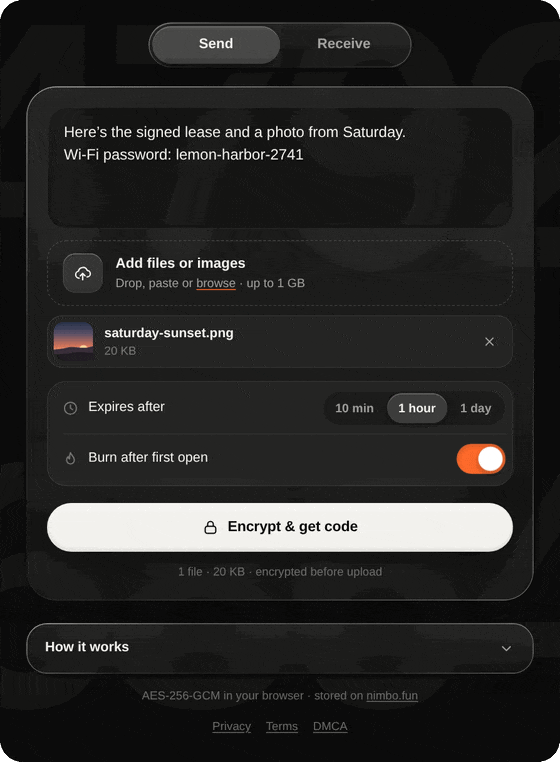
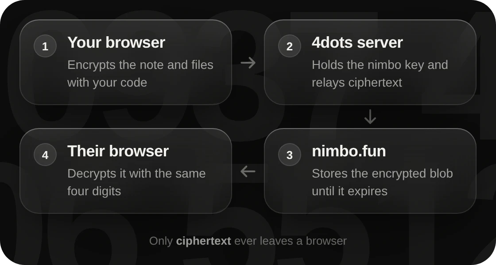
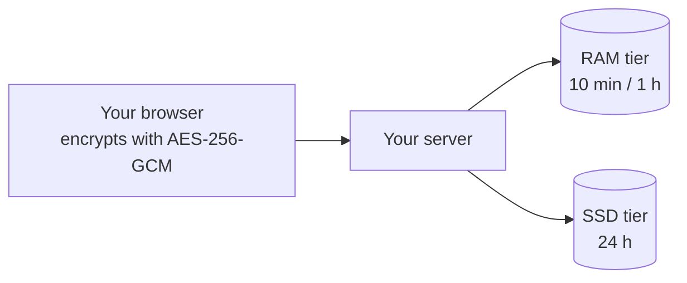

<p align="center">
  <picture>
    <source media="(prefers-color-scheme: dark)" srcset="docs/brand/4dots-mark-on-dark.png">
    
  </picture>
</p>

<h1 align="center">4dots</h1>

<p align="center">
  
</p>

<p align="center">
  <b>Send a note, photo or file. Open it with four digits.</b><br>
  Free, no account, encrypted in your browser.
</p>

<h2 align="center"><a href="https://4dots.app">Open 4dots.app →</a></h2>

<p align="center">
  <kbd>free</kbd> &nbsp;·&nbsp; <kbd>no accounts</kbd> &nbsp;·&nbsp; <kbd>open source</kbd> &nbsp;·&nbsp; <kbd>self-hostable</kbd>
</p>

<p align="center">
  <sub><a href="#how-it-works">How it works</a> · <a href="#run-your-own-copy-optional">Run your own copy</a> · <a href="docs/README.md">Docs</a> · <a href="DEPLOY-MAP.md">Deploy map</a></sub>
</p>

## What it is

4dots is a small file-sharing service you open in a browser: write a note, add photos or files, and get a four-digit code like `4821`. Whoever has the code opens 4dots.app, types it, and gets the drop — no account, no app, no link to forward. Everything is encrypted in your browser before it is uploaded, so the service only ever stores ciphertext. Drops expire after 10 minutes, an hour or a day, and can be set to burn after the first open.

**4dots.app is free, has no sign-up, and is open to everyone.** This repository is its source: the frontend, the encryption, the server and the tests. You can read it, audit it, improve it — and, if you want, run your own copy.

## Why people use it

- **Four digits, nothing else.** No account, no email, no install. Say the code, text it or share the link.
- **Sealed on your device.** AES-256-GCM before anything leaves the browser; the server only sees ciphertext.
- **Gone when it's done.** 10 minutes, 1 hour or 24 hours; burn after reading; delete early.
- **Notes, photos and files up to 1 GB.** Pictures open in the drop with a preview.
- **Open source.** The whole stack is here under the MIT licence.

## See it

<p align="center">
  
</p>
<p align="center"><sub>The composer on a desktop and the code screen on a phone.</sub></p>

<p align="center">
  
</p>
<p align="center"><sub><b>Send:</b> pick a file, press send, read the code. Recorded from 4dots.app.</sub></p>

<p align="center">
  
</p>
<p align="center"><sub><b>Receive:</b> the picture is decoded before it is revealed, so it arrives complete — never half-painted.</sub></p>

<p align="center">
  
</p>
<p align="center"><sub>Follows your system theme: warm black or paper, with one orange accent.</sub></p>

<p align="center">
  
</p>
<p align="center"><sub>The whole form fits on one screen. Typing digits anywhere jumps straight into the code.</sub></p>

<p align="center">
  
</p>
<p align="center"><sub>Switching tabs and sending a drop. The giant digits drifting behind everything are random; they just give the glass something to bend.</sub></p>

## How it works

4dots is end-to-end encrypted. Your browser derives a key from the four-digit code plus a per-code secret from the server, seals the note and files with AES-256-GCM, and uploads only ciphertext. The recipient's browser downloads it and decrypts it locally. **The server never sees the plaintext** — not the hosted service, and not your own copy.

<p align="center">
  
</p>
<p align="center"><sub>The hosted path: the Worker relays ciphertext to nimbo.fun. It never has the key.</sub></p>

**The self-hosted path** has no third-party storage in it:



1. **You get a code.** The server reserves a free four-digit code and hands your browser a one-time upload token.
2. **Your browser seals it.** The note and files are bundled and encrypted in 4 MB chunks, with a key derived from the code (PBKDF2, 600k rounds) plus the per-code secret.
3. **The ciphertext is stored.** On 4dots.app it goes to the hosted storage; in your own copy it goes straight to the RAM or disk tier.
4. **They open it.** Their browser downloads the ciphertext and decrypts it as it arrives. Burn-after-reading drops are deleted once delivered.

## Quick start

### Use it

Open **[4dots.app](https://4dots.app)**. Free, no account, nothing to install. That is the whole setup.

### Run your own copy (optional)

For people who want their own instance: their own disk, their own uptime, and no third party or relay in the path.

```sh
git clone https://github.com/4dotsapp/4dots.git && cd 4dots
cp .env.example .env      # edit if you use a tunnel
docker compose up -d --build
```

Compose joins an external network for your tunnel or proxy. If you do not have one yet, create it first (`docker network create 4dots_default`) or set `FOURDOTS_NETWORK` to an existing network.

24-hour drops land in `drops/` on the host disk (inside the `FOURDOTS_DATA_DIR` volume); the 10-minute and 1-hour tiers live in a tmpfs at `/ram` and disappear on restart. The full guide is in [docs/SELF-HOSTING.md](docs/SELF-HOSTING.md); operators can start with [DEPLOY-MAP.md](DEPLOY-MAP.md).

<details>
<summary><b>Prefer the upstream Cloudflare Worker?</b></summary>

The hosted 4dots.app runs this Worker. It is still a valid way to run 4dots; the self-hosted backend is just another option. You need **Node 20+**.

```sh
git clone https://github.com/4dotsapp/4dots.git
cd 4dots
npm install
npm run dev        # localhost:8787, against a mock of the nimbo API
```

`npm run dev` never touches real storage, so you can play with it straight away.

4dots fits on the **Cloudflare Workers free plan**. You need a [nimbo.fun API key](https://nimbo.fun/profile) for storage.

```sh
npx wrangler login
npx wrangler secret put NIMBO_TOKEN   # paste your nimbo API key
npm run deploy
```

Then add your domain under the Worker's **Settings → Domains & Routes**, or set `workers_dev` to `true` in `wrangler.jsonc` for a free `workers.dev` address. Configuration and the API are in the **[docs](docs/README.md)**.

</details>

## 4dots.app vs your own copy

| | **4dots.app** (hosted) | **Your own copy** |
|---|---|---|
| **Setup** | None — open the site. | Docker on a machine you control. |
| **Storage** | Encrypted blobs on the hosted storage. | Your own RAM and disk. |
| **Limits** | 1 GB per drop; 10 min / 1 h / 24 h. | The same limits, bounded by your disk and memory. |
| **Who runs it** | The 4dots team. | You. |
| **Best for** | Sending something now. | Your own instance, disk and uptime. |

## Storage tiers (your own copy)

The self-hosted backend keeps short-lived drops in memory and long-lived ones on disk:

- **10 minutes and 1 hour → RAM** (a tmpfs at `/ram`). Fast, and gone on restart.
- **24 hours → disk** (`drops/` on the host). Survives restarts.
- **Below 2 GB free memory**, every drop held in RAM is moved to disk, and new short-lived drops are written to disk. Codes, names, sizes and bytes do not change.
- **Memory is volatile.** A restart, reboot or power cut loses the short drops; use the 24-hour option for anything that must survive.

## Security

> [!IMPORTANT]
> A four-digit code is quick to share and also quick to guess: there are only 10,000 of them. 4dots is built for things that matter for minutes, not secrets that must stay secret forever.

- **Client-side encryption.** The note and files are sealed in the browser with AES-256-GCM, using a key derived from the code (PBKDF2-SHA256, 600,000 rounds) plus a per-code secret from the server (the pepper).
- **Storage only sees ciphertext.** On 4dots.app, nimbo.fun stores encrypted blobs under random names; in your own copy, your disk does. Neither learns the code or the pepper.
- **Guessing is slowed down.** Drops expire, can burn after one open, and each IP gets 12 wrong codes per 10 minutes.
- **Tampering fails loudly.** Every chunk is authenticated and numbered, so a reordered, cut-short or altered drop will not decrypt.
- **The ceiling is honest.** Whoever runs the server holds the secret that makes the keys, and with 10,000 codes they could work them out. No four-digit design can avoid that. On 4dots.app that secret belongs to the service; if you run your own copy, it belongs to you.

## Under the hood

- **One Python file.** The self-hosted backend is `server.py`, standard library only: no database server, no cloud storage account. Metadata lives in SQLite; ciphertext lives in a tmpfs and on disk.
- **Frontend.** Plain HTML, CSS and JavaScript modules. No framework, no build step.
- **Crypto.** Web Crypto, with AES-256-GCM in 4 MB chunks and PBKDF2-SHA256 keys.
- **The reveal.** On the Receive tab, pictures are decoded off-document and only then inserted, so a large JPEG never paints half an image.
- **The hosted path.** A Cloudflare Worker streams every byte through, plus one Durable Object that remembers codes, expiry, burns and rate limits. Storage is the [nimbo.fun](https://nimbo.fun/docs) REST API.
- **Motion.** Animation-frame tweens that blur each moving element along its direction of travel, in proportion to its speed. Devices that cannot hold about 40 fps get a lighter mode automatically.
- **Design system.** Colours, glass, components and motion are documented in [DESIGN.md](DESIGN.md).

## Contributing

Issues and pull requests are welcome. Found a security problem? Please report it privately, as described in [SECURITY.md](SECURITY.md).

## License

MIT — see [`LICENSE`](LICENSE). The frontend in `public/` is the upstream 4dots frontend, MIT, © the 4dots authors (see [`LICENSE-4dots-frontend`](LICENSE-4dots-frontend)). The self-hosted backend (`server.py`, `bench.py`, `e2e_test.py`, `test_tiers.py`, `Dockerfile`, `compose.yaml`) is MIT under the same licence.

<br>

<p align="center">
  
</p>
<p align="center">
  <sub><a href="https://4dots.app">4dots.app</a> · <a href="LICENSE">MIT licensed</a> · <a href="https://4dots.app/privacy">Privacy</a> · <a href="https://4dots.app/terms">Terms</a> · <a href="https://4dots.app/dmca">DMCA</a> · Hosted storage by <a href="https://nimbo.fun">nimbo.fun</a></sub>
</p>
